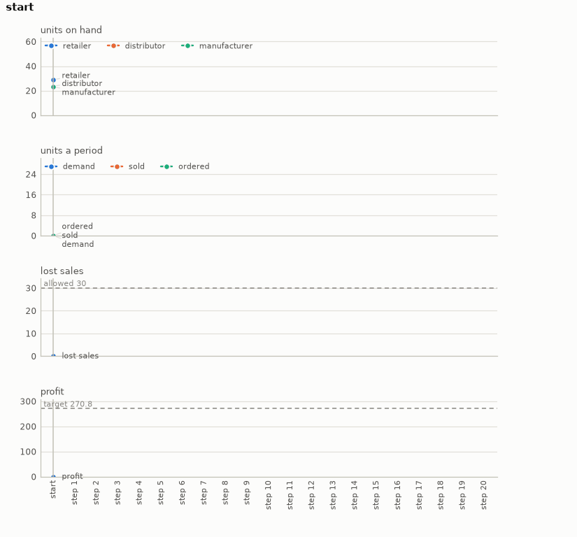

# Inventory

A multi-echelon supply chain on or-gym: a retailer, a distributor and a manufacturer in series,
each ordering from the one behind it, with a raw material supplier at the end that never runs
out. A decision a period for a season: an order-up-to level for the retailer, and one for the
distributor and the manufacturer together. The goal is the season complete with the chain's
profit at or above the target, and the retailer's lost sales never over what the season allows.

- **Import:** `from planiverse.environments.operational.inventory.environment import InventoryEnv`
- **Source:** [`planiverse/environments/operational/inventory/environment.py`](../../planiverse/environments/operational/inventory/environment.py)
- **Instances:** 100 seasons, indices `0` to `99`, all drawn by the generator at recorded seeds
- **Generator:** `generate_instance(seed, ...)`; see [Generating seasons](#generating-seasons)
- **Dependency:** `or-gym`, installed by `scripts/install_or_gym.py` (its own dependency list
  asks for a Gym older than current pip can read)

## Context

The game here is the one a supply chain planner plays. Customers buy from the retailer every
period, and a sale the retailer cannot make from the shelf is lost. The retailer restocks from
the distributor, the distributor from the manufacturer and the manufacturer from the raw
material supplier, and each order arrives after its link's lead time, as far as the supplier's
capacity and stock allow. Each period we set how much stock each stage aims to hold. What makes
it hard is that the stages are coupled through time. Stock held costs money every period it
sits on a shelf, and stock ordered late arrives after the demand it was meant for. A
distributor that runs short starves the retailer a lead time later. The season's last orders
are bought but never sold. Each lost sale counts against a limit, and one sale over it ends the
season.

[or-gym](https://github.com/hubbs5/or-gym) (MIT; Hubbs, Perez, Sarwar, Sahinidis, Grossmann and
Wassick 2020, https://arxiv.org/abs/2008.06319) is a library of operations research problems as
reinforcement learning environments from Carnegie Mellon and Dow. Its multi-echelon inventory
problem (`InvManagement-v1`, the lost-sales variant) is the serial chain above. It is a
dependency installed from PyPI; nothing of it is included here. or-gym also has a network
version (`NetworkManagement`), in which one product moves from raw material nodes through
factories and distributors to several retail markets, along edges that each have their own lead
time and yield. Its decision is an order on every edge, with a pipeline cost on each, which a
few levels a period cannot cover without leaving most of the network unplanned. The serial chain
is used here because its three stages, read in order, make a whole decision a period of nine
choices.

The rules are four. First, the chain is or-gym's, built from the instance: three stages that
hold stock, their holding costs, the capacity and lead time of each supplier, the price, the
unit costs and the penalty for each unit short. A period is or-gym's `_STEP`. It ships each
stage's order, takes in what arrives, meets the period's demand from the retailer's shelf and
charges the period's discounted profit. Second, a period is one decision: `stock(r, u)`, the
retailer's order-up-to level `r` and the distributor's and manufacturer's `u`, each `low`,
`mid` or `high`. Third, a period that takes the retailer's lost sales over the season's
allowance is a dead end. Fourth, the goal is the last period done with the profit at or above
the target. The season ending otherwise is a dead end.

## Actions

| Action | Cost | Retailer | Distributor and manufacturer | Effect |
|---|---|---|---|---|
| `stock(r, u)`, `r` and `u` in `low`, `mid`, `high` | 1 | orders up to its level `r` | each order up to its level `u` | a period passes with the orders the levels ask for |

Nine actions in all, and `get_actions` offers all nine in every state; `InventoryAction` refuses
any other level with a `ValueError`, and a goal or dead-end state has no successors at all. A
level is an echelon level (i.e., it counts the stock at the stage and at every stage downstream
of it, on hand and in transit). Each instance sets three for each stage, at 0.8, 1.1 and 1.4
times the mean demand over the stage's cumulative lead time and the period in hand. Applying an
action looks up the three stages' levels and asks or-gym's `base_stock_action` for the orders.
Each order is the level less the stage's echelon position, never below zero, and capped at the
supplier's capacity and stock. or-gym's `_STEP` then runs the period. Note that
`base_stock_action` in or-gym 0.5.0 reads the position from a method that stores it without
returning it, so it fails with a `TypeError`. The environment's subclass of the chain returns it,
and that is the only change made to or-gym's code. The distributor and the manufacturer share a
level because the retailer's level decides the sales and the lost sales directly. The upstream
level decides how fast stock moves towards it, and one setting for both keeps the decision to
nine choices a period.

## Planning problem

An `InventoryState` holds the period, the stock on hand at each stage, the shipments in transit
to each (one entry for each period of the link's lead time, the next to arrive first), the
profit so far and the retailer's lost sales so far. It also holds the last period's demand,
sales, lost sales and the retailer's order as shipped. Two states are the same state when their
period, stock, shipments, profit (to the cent) and lost sales are the same. or-gym's state is
plain arrays, so the environment writes a state's numbers into them and steps one period. Two
order histories that leave the same chain and the same money are therefore one state. The
literals name every part of that identity, because the planners' closed lists key on literals:

```
period(4)
lost(0)
profit(75.12)
on_hand(retailer, 1)
in_transit(retailer, 1, 23)
in_transit(retailer, 2, 0)
...
```

With `P` the profit the target asks for, `A` the lost sales the season allows and `H` its
length in periods, the goal and the dead end are

```
goal(s)     ≡ period(s) = H ∧ lost(s) ≤ A ∧ profit(s) ≥ P
terminal(s) ≡ lost(s) > A ∨ (period(s) = H ∧ ¬goal(s))
```

Note that the problem as a planner of a supply chain would state it is not an initial-to-goal
problem but a trajectory problem (i.e., one whose requirements hold over the whole run rather
than at its end). The service level must hold every period, and the profit is what the whole
season earns. We turn it into the goal above with the reduction the other operational
environments share, which [docs/operational.md](../operational.md) sets out in full, in three
moves. First, a constraint that must hold throughout becomes a dead end: the first period that
takes the lost sales over the allowance is terminal, so no plan through it exists. A check over
the whole trajectory thus becomes a check at each state. Second, a quantity that accumulates
becomes part of the state and is bounded at the goal. The profit is carried on the state, added
to every period, and compared with the target when the season is done. Third, the horizon
becomes time in the state: the period is a state variable, so "by the end of the season" is a
condition on a state. The cost of the reduction is that the goal depends on a target, and a
target has to come from somewhere. Here it is the most profit any fixed base-stock policy earns
inside the allowance (see [Generating seasons](#generating-seasons)). Every instance is thus
solvable by construction, and the planner is asked to do at least as well as the best rule by
varying the levels period by period.

The progress measure the width planners take (`planiverse.benchmark.measures.inventory`) is the
periods still to run, plus the target's shortfall from the state's `worth` in periods' worth of
the target. The worth is the profit with every unit in the chain counted at the raw material
price. or-gym's profit is the chain's: what one stage pays another is the other's revenue, so
the two cancel, and a unit costs the chain the raw material price when the manufacturer orders
it. Counting the stock at that price keeps a period that buys stock from looking like a period
that lost money. At the end of the season unsold stock is worth nothing, and the worth is the
profit alone.

## An example

Instance `0` is a season of 20 periods with a uniform demand of 9 to 16 units a period, 251 in
all, and an allowance of 30 lost sales. The retailer's lead time is two periods, the
distributor's one and the manufacturer's three. The suppliers can ship 30, 31 and 22 units a
period. The stages start with 29, 24 and 23 units. A unit sells for 2.69 and costs the chain
0.60 in raw material. The target asks for a profit of 270.76. The twenty-period plan the render
below shows is

```
stock(high, high), stock(mid, high), stock(high, high), stock(mid, high),
stock(low, high), stock(low, high), stock(low, high), stock(high, high),
stock(high, low), stock(high, high), stock(mid, high), stock(high, high),
stock(high, high), stock(high, high), stock(low, high), stock(mid, low),
stock(low, low), stock(mid, low), stock(low, low), stock(low, low)
```

which keeps the upstream level high for most of the season and moves the retailer's level
period by period. The first four periods sell everything at high and mid. Periods five to seven
hold the retailer at low while the stock behind it builds up. The retailer runs out in period
seven and loses 12 sales, and 13 more in period eight, since an order raised then arrives two
periods later. Periods nine to fourteen hold the retailer at high or mid, and nothing is lost.
The last six periods hold the retailer at low or mid, and the last five the upstream level at
low, so that little is bought that cannot be sold. The run-down loses 4 more sales in period
seventeen, 29 of the 30 allowed, and the season ends at 271.17. The policy the season was accepted on (both levels high for
sixteen periods, then both low for four) ends at 270.76, which is where the target comes from.



The render draws the readings of each state over the plan rather than the state's text, since a
state here is a handful of numbers. The panels are the stock on hand at each stage, the period's
demand, sales and the retailer's order as shipped, the lost sales against the allowance, and
the profit against the target, period by period. A frame of the GIF is the chart up to its
state, so the animation grows a step at a time. The same plan is also a
[sheet](../renders/inventory_chart.png), the whole plan on one figure. There the action that
produced each state runs along the bottom, the allowance and the target are dashed lines, and
the goal is marked where the plan ends. Both were generated by solving the instance and handing
the trace to `render_trace`:

```python
from planiverse.environments.operational.inventory.environment import InventoryEnv
from planiverse.benchmark import measures
from planiverse.planners.width import BFWS

env = InventoryEnv()
env.set_index(0)
state, info = env.reset()          # info: season, target, allowed, generated
print(state)                       # period 0: on hand retailer 29, distributor 24, ...

result = BFWS(width=1, progress=measures.inventory).solve(env)
trace = env.simulate(result.plan)

env.render_trace(trace, "inventory_chart.gif")                                   # animated
env.render_trace(trace, "inventory_chart.png", actions=result.plan, env=env)     # the sheet
```

Stateful play goes through the environment's OpenSpiel game,
`pyspiel.load_game("planiverse_inventory")`, whose `apply_action` advances a state (see [Through
OpenSpiel](../../README.md#through-openspiel)). `successors(state)` returns the action and state
pairs for all nine actions.

## Seasons

The hundred seasons are the generator's own draws, embedded in the module as the plain data
`set_instance` takes (`periods`, `demand`, `initial`, `price`, `costs`, `penalties`, `holding`,
`capacity`, `lead_times`, `discount`, `levels`, `allowed`, `target`) with the seed, the demand
distribution and its parameters beside them. The plan each was accepted on is in
`tests/data/inventory_solutions.json`.

## Generating seasons

`generate_instance` draws a season, selects it, and returns it as the dict `set_instance` takes
back:

```python
env = InventoryEnv()
season = env.generate_instance(seed=7)
print(env.witness, env.witness_expansions)     # the policy it was accepted on, and the policies measured
```

| Option | Default | What it does |
|---|---|---|
| `periods` | drawn, 12 to 20 | the season's length |
| `attempts` | 60 | draws before giving up with `GenerationError` |

The demand distribution is one of or-gym's four (Poisson, binomial, uniform and geometric) with
drawn parameters, and the season's demand is drawn from it once. The costs, capacities, lead
times (one to three periods), initial stock and penalties are drawn round or-gym's own defaults
and scaled to the mean demand, and the allowance is 4 to 12 per cent of the season's demand.
The 33 policies of `reference_plans` are then run: each of the nine settings held all season,
and each of the eight other than `stock(low, low)` held until the last two, three or four
periods and then run down at `stock(low, low)`. The target is the most profit any of them ends
the season with inside the allowance, and that policy is kept as the witness. A draw is thrown
back when none of them gets through. The same seed always gives the same season.

## Determinism

or-gym draws each period's demand from a scipy distribution on numpy's global random state, so
two runs of the same orders see different customers. The environment draws the whole season's
demand once, from the instance's seed with Python's own generator, and hands it to or-gym as its
user-supplied demand (`dist=5`). A period's demand is then the instance's, whatever led to it.
Expanding a state writes its stock, its shipments and its period into or-gym's arrays over
whatever an earlier expansion left there, and steps from it, so a state's children do not
depend on the order states are expanded in. The tests check this against a straight run of
or-gym through a plan with expansions in between.

or-gym 0.5.0 was written against numpy 1 and gym 0.19. The environment puts back two aliases
numpy 2 removed (`np.Inf`, which `_STEP` uses for the raw material supplier's unlimited stock,
and `np.product`) before or-gym runs. Gym 0.26's notice at import that it does not support numpy
2 is kept off the console, since the parts of gym that or-gym uses here (its `Env` base class
and `spaces.Box`) work.

## Rendering

`str(state)` describes a period in one line: the stock on hand at each stage, the units in
transit to each, the last period's demand, sales and lost sales, and the lost sales and profit
so far against the allowance and the target. The readings a state charts, and the panels they go
on, are its own `readings()` and `panels`; `charts=False` asks `render_trace` for the state's
text instead, and [docs/rendering.md](../rendering.md) covers the other output formats.

## Files

| File | Contents |
|---|---|
| [`environment.py`](../../planiverse/environments/operational/inventory/environment.py) | `InventoryAction`, `InventoryState`, `reference_plans`, `InventoryEnv`, `SEASONS` |
| [`tests/test_inventory.py`](../../tests/test_inventory.py) | Tests |
| [`tests/data/inventory_solutions.json`](../../tests/data/inventory_solutions.json) | The policy each season was accepted on |
