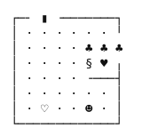

# Adventures of Lolo

Adventures of Lolo's puzzle, re-implemented in Python rather than emulated, over the first 100 of
the cartridge's own 163 rooms. Lolo walks the four directions, one cell at a time, on an 8 by 8
board. He has to collect every heart framer (i.e., the collectible hearts that open the door) and
then stand on the open door. The rules below come from observing the cartridge, and the
environment needs no ROM, no emulator and no dependencies.

- **Class:** `LoloGame`
- **Import:** `from planiverse.environments.games.lolo.environment import LoloGame, LoloAction`
- **Source:** [`planiverse/environments/games/lolo/environment.py`](../../planiverse/environments/games/lolo/environment.py)
- **Instances:** 100 rooms, indices `0` to `99`: the first 100 of the cartridge's 163
- **Generator:** `generate_instance(seed, hearts=None, framers=None, snakeys=None, ...)`; see [Generating rooms](#generating-rooms)
- **Dependencies:** none

## Context

Adventures of Lolo is a single-screen puzzle. A room is an 8 by 8 board of floor, rocks, trees and
rivers with a door on it, a few heart framers, some Emerald Framers (i.e., blocks Lolo can push)
and some enemies. Lolo starts somewhere on the floor. He walks one cell at a time, pushes what can
be pushed, collects the hearts, and may fire a magic shot at an enemy once a magic heart has given
him one. The door opens when every heart is collected, and standing on it clears the room. What
the player decides is the order of the hearts and where the Framers and the eggs end up. A Framer
shields Lolo from a Medusa's line and a pushed egg can bridge a river, and a Medusa kills him the
moment he steps into its clear line.

The rules are eight. First, a step into a rock `#`, a tree `T`, a river `~` or the edge is
refused. Second, a step into a one-way pass (`v`, `<`, `^` or `>`) is refused if it goes against
the arrow, and allowed from the other three sides. Third, a step into an Emerald Framer `O` or an
egg `e` pushes it one cell the same way, if the cell behind is empty walkable ground. Nothing can
be pulled, and no chain of two can be pushed. A river refuses a Framer always, and refuses an egg
only where the current would carry the raft. Elsewhere the egg floats into a raft Lolo may stand
on and which drifts away once he steps off it, and `rafts=False` goes back to refusing every
river. Fourth, a step onto a heart framer collects it, and `h`, the second of the cartridge's two
heart codes, also gives Lolo two magic shots, whereas plain `H` gives none. Fifth, a step into an
enemy is refused, and enemies never move. Sixth, `shoot` fires one cell in the direction Lolo last
tried to move, whether or not that move succeeded. An enemy there becomes an egg, which can then
be pushed; an egg there is blasted out of the room; and each shot costs one. Seventh, a Medusa `M`
kills Lolo when he stands anywhere in its row or column, unless a tree, an Emerald Framer, a heart
framer, an enemy or an egg stands between them. Rocks, rivers, bridges, deserts, flower beds,
one-way passes and break tiles do not block a Medusa. Eighth, the door `D` opens once every heart
framer is collected, and standing on the open door clears the room.

We re-implemented the game rather than run the cartridge, so the rules are ours to read. It
differs from the cartridge in the ways set out below.

**Six of the eight enemies are frozen here.** Snakey and Medusa never move on the cartridge
either, so rooms holding only those two are modelled exactly. The other six (Leeper, Rocky, Alma,
Gol, Skull and Don Medusa) do move there, in lock-step with Lolo, and this module leaves them
where they started. Freezing is not a relaxation: a frozen enemy is a wall as well as a threat
removed, so a room that contains one can come out easier or harder here than it is on the
cartridge. `EXACT_ROOMS` lists the 21 rooms of the hundred that ship whose enemies are only those
two (26 of the cartridge's 163), and `reset` reports it room by room:

```python
from planiverse.environments.games.lolo.environment import EXACT_ROOMS
len(EXACT_ROOMS)      # 21

state, info = game.reset()
info["exact"]                  # True when the model is faithful for this room
info["unmodelled_enemies"]     # ('K', 'R'), the kinds that would have moved
```

**Rafts float on the rivers that hold still.** On the cartridge an egg shoved into a river floats,
and Lolo can step onto it and ride across, which is how `int 1-3` is cleared. The cartridge has
six river codes and they do not behave alike:

| Code | Push an egg into it | Lolo steps on |
|---|---|---|
| `$82` | refused | n/a, and it appears in none of the cartridge's 163 rooms |
| `$84`, `$86`, `$87` | accepted | rides, and the raft stays put |
| `$83` | accepted | rides, and the raft drifts **up** |
| `$85` | accepted | rides, and the raft drifts **down** |

The room texts spell all six `~`, so the text alone cannot tell one river from another;
`DRIFTING_RIVERS` carries the `$83` and `$85` cells, read back out of the cartridge. An egg pushed
at a still river floats; an egg pushed at a drifting one is refused, because a current runs on
frames and not on moves (on `tutorial 14a`'s `$83` channel the raft carries Lolo one cell every
160 frames with no button held), and the module has no notion of time.

Of the 111 rooms with a river, 71 have no current anywhere, and the rule this module keeps is the
cartridge's own for every one of them, which is why rafts are on by default. The cartridge's own
twelve-action plan for `int 1-3` is a plan here:

```python
game = LoloGame()
game.set_index(40)                     # int 1-3
# right right up shoot up up up left left up up up
```

**The hammer is not modelled.** A few rooms start with one in the cartridge's PWR meter, `int 1-5`
among them.

Two smaller divergences run in the safe direction. First, Medusa's shot is instant here where the
cartridge gives one move of grace, but that move cannot be used to escape, so no plan is lost.
Second, an Emerald Framer is not pushed onto a heart framer, a door or a marker.

**A marker does not block a Medusa here.** A marker (the `$97` to `$9C` codes) is transparent
to a Medusa's line, like the terrain listed under rule 7.

## Actions

The action set holds five actions, each costing 1:

| Action | Cost | Effect |
|---|---|---|
| `left`, `up`, `down`, `right` | 1 | step one cell, pushing a Framer or an egg ahead, and turn Lolo to face that way |
| `shoot` | 1 | fire a magic shot into the cell Lolo faces |

A step is refused by a rock, a tree, a river, the edge, an enemy, a one-way pass entered against
its arrow, or a push with nothing to push into. Note that a refused move is still a successor when
it leaves Lolo facing somewhere new, because the facing is what decides where the next shot goes.
Walking into a rock to turn is a real move in this game. A shot is refused when the meter is
empty, when Lolo has not yet tried a move (he starts facing nowhere, and the cartridge will not
fire before the first move either), or when the cell he faces holds neither an enemy nor an egg.
`successors` drops every refused action, and a goal state or a dead end has no successors at all.

The meter starts empty, as the cartridge does on a cold boot, because the meter belongs to the
player rather than to the room. `magic_shots` sets the starting meter, for a room that needs a
shot it cannot earn in-room:

```python
game = LoloGame(magic_shots=2)
```

Applying an action runs one step and then settles it. The Framer or the egg moves, a heart is
collected and its shots credited, and a raft floats away once Lolo has stepped off it. The Medusa
lines are then checked at the new position, because a push can open one: shoving away the Framer
that was shielding Lolo kills him as surely as walking into the line himself.

## Planning problem

A `LoloState` holds where Lolo is and which way he faces, the hearts still on the board, the
Framers, the eggs and the sunken eggs (i.e., the rafts). It also holds the enemies still alive,
the shots left and a depth counter. The room's terrain and its door are held once, on the `Room`
every state of it points to. Two states are the same state when everything but depth agrees,
facing included, since the facing decides where the next shot goes; a position reached two ways
therefore compares equal and search can close it. The literals are:

| Literal | When |
|---|---|
| `at(lolo, r, c)`, `hearts-left(n)`, `shots(n)` | always |
| `facing(d)` | once Lolo has tried a move |
| `at(heart, r, c)`, `at(framer, r, c)`, `at(egg, r, c)` | per heart, Framer and egg on the board |
| `at(sunken-egg, r, c)`, `at(enemy, r, c)` | per raft and per enemy still alive |
| `door-open` | every heart collected |
| `goal-reached`, `terminal-state` | in a goal state and in a dead-end state |

With `hearts(s)` the hearts still to collect, `lolo(s)` Lolo's cell and `door` the door's cell,
let `exposed(s)` say whether Lolo's cell lies in the clear line of a live Medusa. The goal and the
dead end are

```
goal(s)     ≡ hearts(s) = 0 ∧ lolo(s) = door ∧ ¬exposed(s)
terminal(s) ≡ exposed(s)
```

Both are absorbing (i.e., no action leads out of them): `successors` returns nothing for either,
and `simulate` carries the state through unchanged. A room that puts Lolo in a Medusa's line at
the start is born terminal, which the cartridge does too, and the generator rejects such a draw.

The game as played runs on frames: Lolo walks at a fixed speed, a Medusa fires when he crosses its
line, and a raft slides on its current. The room is won when he reaches the open door. We turn it
into an initial-to-goal problem in two moves. First, the loop between two presses (the walk of one
cell, the push, the collection, the raft floating away and the Medusa's shot) is folded into the
action, as described above, so a state is always a settled board with Lolo on a cell. Second, the
game's win and loss conditions become the goal test and the dead-end test on that board. The win
is the hearts and the door, and the loss is the Medusa's line, decided at once on arrival. What
the reduction cannot carry is anything the cartridge does on frames rather than on moves, which is
why the drifting rivers refuse the push. The six enemies the cartridge moves stand still here too,
as set out above. Every action costs 1, so a plan is judged by its length.

The progress measure the width planners take (`planiverse.benchmark.measures.lolo`) is the hearts
still to collect plus one until Lolo is on the door, with a dead state pinned at 99, above any
live distance.

## An example

Instance `0` is `tutorial 1a`, the first of the tutorial's 19 puzzles. It holds two hearts, the
magic `h` and the plain `H`, a Snakey `S` beside the plain heart, and three trees among the rocks.
The door `D` is on the top edge at `(0, 2)`, and Lolo starts at `(6, 5)` with no shots. Its only
enemy is a Snakey, so it is a room the model is exact for:

```
##D#####
#......#
#....TTT
#....SH#
#....###
#......#
#.h..@.#
########
```

A nineteen-move plan for it is

```
left, left, left, up, up, up, right, right, shoot, shoot, right, right, left, left, left, left,
up, up, up
```

which walks Lolo left to the magic heart for its two shots, then up three rows and right until he
faces the Snakey. Two shots turn it into an egg and blast the egg out of the room. He steps
through to the plain heart, which opens the door, and walks back across and up the column to the
door.



The render is the state's own text, typeset, one frame per state. `render_trace` falls back to
`str(state)` for an environment with no screen to photograph, and for a board this small the text
is the clearest picture of it. The same plan is also a [contact sheet](../renders/lolo.png), every
frame on one image, captioned with the step number, the action that produced it, and a note on the
goal state. Both were generated by solving the instance and handing the trace to `render_trace`:

```python
from planiverse.environments.games.lolo.environment import LoloGame
from planiverse.benchmark import measures
from planiverse.planners.width import BFWS

env = LoloGame()
env.set_index(0)
state, info = env.reset()
print(state)                       # the room above
print(info)                        # {'room_index': 0, 'room': 'tutorial 1a', 'generated': False,
                                   #  'hearts': 2, 'shots': 0, 'door': (0, 2), 'start': (6, 5),
                                   #  'exact': True, 'unmodelled_enemies': (), 'rafts': True}

result = BFWS(width=1, progress=measures.lolo).solve(env)
trace = env.simulate(result.plan)

env.render_trace(trace, "lolo.gif")                                   # animated
env.render_trace(trace, "lolo.png", actions=result.plan, env=env)     # contact sheet
```

Stateful play goes through the environment's OpenSpiel game,
`pyspiel.load_game("planiverse_lolo")`, whose `apply_action` advances a state (see [Through
OpenSpiel](../../README.md#through-openspiel)). `successors(state)` returns the action and state
pairs for the moves that change the position, with `successor.lolo` and `successor.hearts_left`
on each. `make("lolo", index=38)` selects room 38, `int 1-1`. See
[docs/rendering.md](../rendering.md) for the other output formats.

## Rooms

The environment ships the first 100 of the cartridge's 163 rooms at indices `0` to `99`, the
cartridge's own order. They are decoded out of the cartridge's room table rather than transcribed
by hand.

| Indices | `label` | What |
|---|---|---|
| 0 to 37 | `tutorial 1a` … `tutorial 19b` | 19 puzzles, each stored twice |
| 38 to 99 | `int 1-1` … `int 5-6` | 4 intermediate floors of 14 and the first 6 of the fifth |

The tutorial's 19 puzzles are each stored twice, once as the demonstration the game plays for you
and once as the room to try. The two halves of a pair are near-identical but not equal, so the
cartridge's 163 slots hold 144 distinct puzzles. The cartridge goes on to the rest of the fifth
floor, ten advanced floors of 5 and five Pro rooms, which are past the hundred that ship.

Print any of them:

```console
$ python -m planiverse.environments.games.lolo.environment --room 0
---   0 tutorial 1a  2 hearts
  |##D#####|
  |#......#|
  |#....TTT|
  |#....SH#|
  |#....###|
  |#......#|
  |#.h..@.#|
  |########|
```

## Generating rooms

`generate_instance` draws a fresh room, selects it, and returns it as a room text (eight rows of
eight glyphs joined by `|`, as in `ROOMS`) that `set_instance` accepts back:

```python
game = LoloGame()
room = game.generate_instance(seed=7)     # or make("lolo", seed=7)
state, info = game.reset()                # info["generated"] is True, info["exact"] too
game.witness                              # the plan the draw was accepted on
```

| Option | Default | What it does |
|---|---|---|
| `hearts` | a bundled one's | heart framers, of which `magic_hearts` (also a bundled one's) are magic |
| `framers` | a bundled one's | Emerald Framers to push |
| `snakeys`, `medusas` | a bundled one's | the two enemies this module models exactly |
| `rocks`, `trees` | a bundled one's | share of the board turned to rock and to tree |
| `solvable` | `True` | search each draw and keep only one with a plan |
| `min_plan_length` | 8 | reject a draw whose shortest plan is shorter |
| `search_limit` | 50000 | expansions the check may spend per draw |
| `attempts` | 200 | draws before giving up with `GenerationError` |

Only Snakey and Medusa are ever placed, so a generated room is one the module is faithful for:
`info["exact"]` is always true. A Medusa in line with Lolo's start kills him before he moves, and
that draw is rejected like any other with no plan. The check is breadth-first, so
`min_plan_length` bounds the shortest plan from below. The cost is that the generator favours
rooms a small search can decide, and a caller who wants harder ones has to raise `search_limit`.

Left unset, the inventory comes from one of the cartridge's rooms this module is exact for, drawn
at random (`PROFILES`, one per room in `EXACT_ROOMS`). That is its hearts and how many are magic,
its Emerald Framers, Snakeys and Medusas, and the shares of the board that are rock and tree. A
generated room is therefore stocked like a real one. The method is generate-and-test, which the
procedural content generation literature calls search-based PCG (Togelius, Yannakakis, Stanley and
Browne, 2011, https://doi.org/10.1109/TCIAIG.2011.2148116; Shaker, Togelius and Nelson,
*Procedural Content Generation in Games*, 2016, https://pcgbook.com/). The test is breadth-first
search, and the same seed and options always give the same room.

## Rendering

`str(state)` draws the board in the glyphs listed under [Context](#context), with `e` for an egg
and `@` for Lolo. See [docs/rendering.md](../rendering.md) for the other output formats.

## Files

| Path | What |
|---|---|
| [`environment.py`](../../planiverse/environments/games/lolo/environment.py) | `LoloGame`, `LoloAction`, `LoloState`, `Room`, `ROOMS`, `EXACT_ROOMS`, `DRIFTING_RIVERS` |
| [`tests/test_lolo.py`](../../tests/test_lolo.py) | Tests |
| [`tests/data/lolo_solutions.json`](../../tests/data/lolo_solutions.json) | The plan found for each of the 29 rooms solved, with the meter seeded to two |
