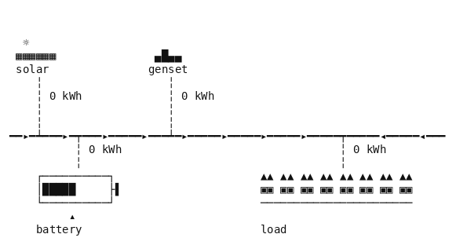

# Microgrid

Microgrid operations on python-microgrid: a load, solar panels, a battery and, depending on the
microgrid, a diesel genset, a connection to the grid, or both. A decision every three hours for a
day and a half or two days: what the battery does, and whether the genset runs. The goal is the
horizon reached with every hour's load met, the operating cost at or under the target, and the
battery at least as charged as it was found.

- **Class:** `MicrogridEnv`
- **Import:** `from planiverse.environments.operational.microgrid.environment import MicrogridEnv`
- **Source:** [`environment.py`](../../planiverse/environments/operational/microgrid/environment.py)
- **Instances:** 100, indices `0` to `99`, all drawn by the generator at recorded seeds
- **Generator:** `generate_instance(seed, microgrid=None, horizon=None, attempts=40)`; see
  [Generating instances](#generating-instances)
- **Dependency:** `pymgrid` (the PyPI package `python-microgrid`). Its twenty-five benchmark
  microgrids ship inside it, so there is nothing to download.

## Context

The game here is the one a microgrid operator plays. Solar comes in through the middle of the
day, the load runs all day and into the night, and the battery can move energy between the two,
at a loss of ten per cent each way and a small wear cost per kWh. What solar and the battery do
not supply comes from the grid, at a price that changes with the time of day, or from the genset,
whose fuel and carbon cost more than the grid's. On a microgrid without a grid the genset is the
only source left at night, and on one with a grid an outage hour leaves the genset as the only
backup. Each period we set two things: the battery's setting and the genset's switch. What makes
it hard is that the decisions are coupled across the horizon. Energy stored at noon covers the
evening and keeps the genset off then, but a battery that is full at noon cannot take the
afternoon's surplus. The battery must also be handed back at least as charged as it was found, so
whatever is drawn from it has to be put back before the horizon ends.

[python-microgrid](https://github.com/ahalev/python-microgrid) (`pymgrid`, LGPL-3.0; Henri,
Levent, Halev, Alami and Cordier 2020, https://arxiv.org/abs/2011.08004) is the microgrid
simulator they describe there. A microgrid is a set of modules: a load, a renewable
source, a battery, a genset, a grid, and an unbalanced-energy module that takes up whatever the
others leave over and charges for it. A step dispatches the modules for an hour and charges each
its cost. The package ships twenty-five benchmark microgrids, `pymgrid25`, each with a year of
hourly load, solar, grid price, carbon intensity and grid outages, which
`Microgrid.from_scenario` reads from the package's own data directory. It is a dependency
installed from PyPI; nothing of it is included here.

The rules are four. First, the microgrid is pymgrid's scenario microgrid, set to the instance's
hour of the year and its battery to the instance's state of charge. pymgrid steps it an hour at
a time: the battery's efficiency and limits, the genset's minimum and maximum output, the grid's
import cap, price, carbon cost and outages, solar curtailment and the cost of each hour are all
pymgrid's. Second, a period is one decision held for three hours: `operate(mode, genset)`, the
battery's mode and the genset `on` or `off`. The grid, where there is one, takes the balance.
Third, an hour in which any load goes unmet is a dead end. Fourth, the goal is the horizon
reached with the operating cost at or under the target and the battery at or above its reserve.
The horizon reached otherwise is a dead end.

## Actions

| Action | Cost | Battery | Genset | Effect |
|---|---|---|---|---|
| `operate(idle, g)` | 1 | neither charges nor discharges | `g` | three hours with the load met by solar, then the genset if on, then the grid |
| `operate(store, g)` | 1 | charges from the solar surplus only | `g` | as `idle`, with any solar beyond the load stored rather than curtailed |
| `operate(cover, g)` | 1 | stores the solar surplus and discharges to meet the rest of the load | `g` | the battery takes over from the genset and the grid as far as its charge allows |
| `operate(charge, g)` | 1 | charges at its full rate, from solar first and then from the genset or the grid | `g` | the battery fills, at the cost of buying the energy |

`g` is `on` or `off`. A microgrid with a genset offers all eight actions in every state, and one
without offers the four with `off`; `get_actions` returns the instance's list, and
`MicrogridAction` refuses any other mode or switch with a `ValueError`. A goal or dead-end state
has no successors at all. Applying an action steps pymgrid's `Microgrid` three hours. Each hour
the environment works out what to ask of each module. The battery is asked for its mode's flow,
within what pymgrid says it can take or give at its charge. A running genset is asked for what
solar and the battery leave over, within its minimum and maximum output. The grid is asked for
what is left after that, within its import cap and nothing in an outage hour, and exports what a
running genset makes beyond the load. pymgrid then steps the microgrid, uses solar for whatever
the controllable modules leave unmet, and books anything still unmet as loss of load (at 10 a
kWh) and anything left over as overgeneration (at 1 a kWh). The hour's cost is the negative of
pymgrid's reward: the genset's fuel and carbon, the grid's import and carbon, the battery's wear,
and those two penalties.

## Planning problem

A `MicrogridState` holds the hours elapsed, the battery's charge (to a tenth of a kWh), the
operating cost so far (to a hundredth) and the loss of load so far, with the last period's
energy flows (load, solar used, battery out, genset and grid in) kept for display. Two states
are the same state when those four are the same. pymgrid's modules carry no state besides the
hour and the battery's charge, since the scenario gensets start and stop within the hour, so the
environment expands a state by setting each module to the state's hour and the battery to its
charge, and stepping the microgrid from there. The literals name the hour, the state of charge
in whole per cent and the cost in whole per cent of the target, with `lost_load` added once any
load has gone unmet:

```
hour(12)
soc(40)
cost(23)
```

With `C` the cost the target allows, `R` the reserve as a share of the battery's capacity and `H`
the horizon, the goal and the dead end are

```
goal(s)     ≡ hour(s) = H ∧ lost(s) = 0 ∧ cost(s) ≤ C ∧ soc(s) ≥ R
terminal(s) ≡ lost(s) > 0 ∨ (hour(s) = H ∧ ¬goal(s))
```

The problem as an operator would state it is a trajectory problem (i.e., one whose requirements
hold over the whole run rather than at its end): meet the load every hour, keep the cost down
over the horizon, and leave the battery as it was found. We turn it into the goal above with
the reduction the other operational environments share, which
[docs/operational.md](../operational.md) sets out in full, in three moves. First, the constraint
that must hold throughout becomes a dead end: the first period with any loss of load is
terminal, so no plan through it exists. pymgrid keeps the battery inside its limits itself, so
its state of charge never leaves them and needs no dead end of its own. Second, the cost
accumulates in the state and is bounded at the goal. Third, the horizon becomes time in the state.
The reserve is a condition on the final state. The target comes from the reference policies (see
[Generating instances](#generating-instances)): each instance's target is the least cost any of
them ends with inside the constraints, and its plan is kept as the witness. Every instance is
thus solvable by construction, and the planner is asked to do at least as well as the best rule
of thumb.

Three hours a decision keeps the depth at eight, twelve or sixteen for horizons of 24, 36 and 48
hours, and the branching factor at four or eight.

The progress measure the width planners take (`planiverse.benchmark.measures.microgrid`) is the
periods still to run plus the cost so far as a share of the target.

## An example

Instance `0` is pymgrid's microgrid 2, which has solar, a battery and a genset and no grid. The
battery holds 66,116 kWh, of which the lowest fifth is out of reach, and charges or discharges
at up to 16,529 kWh an hour. The genset runs between 2,429 and 43,726 kWh an hour at 0.6 a kWh
in fuel and carbon. The instance starts on day 255 at 06:00 with the battery at 0.51 of its
capacity, which is also the reserve, and runs 36 hours. The load over those hours is 858,690
kWh, from 9,256 to 33,049 an hour, and solar could give 607,060 kWh, up to 45,394 an hour. The
target allows a cost of 202,446.86. The twelve-period plan BFWS finds, which the render below
shows, is

```
operate(cover, on), operate(store, on), operate(store, off), operate(cover, on),
operate(cover, on), operate(idle, on), operate(idle, on), operate(idle, on),
operate(idle, on), operate(store, off), operate(store, off), operate(cover, on)
```

The plan runs the battery down from 0.51 to its floor of 0.20 through the first morning, with
the genset making up the rest. From nine to noon it stores the solar surplus, back to 0.47, with
the genset filling the hours solar falls short. From noon to three solar alone covers the load,
the genset is off, and the battery fills to 1.00. Through the evening it covers the load from the
battery, down to 0.40 by six and to its floor by nine, and the genset carries the night and the next morning.
The next day solar fills the battery again from nine to three with the genset off, and the last
period draws it down to 0.53, above the reserve of 0.51, at a cost of 202,446.86, exactly the
target. The witness the instance was accepted on is `cover` throughout with the genset as a
backup, which costs the same: where the battery is at its floor `idle` and `cover` do the same
thing, and where solar meets the load `store` and `cover` do too.



Each frame is the state's picture, a one-line diagram of the microgrid. Solar, the genset and the
grid, those of them the microgrid has, feed the load bus from above, with the genset's switch and
the grid's direction beside them; the battery and the load hang below it. Each link carries the
last period's energy in kWh with an arrow for its direction, and is dashed when nothing flowed.
The battery is a gauge filled to its state of charge, with the reserve it must end at or above
marked beside it. Under the diagram is a status line with the hour of the horizon and the clock,
the cost so far against the target, and the charge against the reserve, and any load unmet.

| Mark | Meaning |
|---|---|
| `━━┷━━` `━━┯━━` | the load bus, and a link joining it from above or below |
| `▼ 120 kWh` | a link and the energy it carried last period, in the arrow's direction |
| `╎ 0 kWh` | a link that carried nothing |
| `│██│` | the battery, filled to its state of charge |
| `◂ reserve` | the charge the battery must be at or above when the horizon ends |
| `☼ solar`, `genset on`, `grid import`, `⌂ load` | the modules |

The same plan is also a [sheet](../renders/microgrid.png), every state on one figure, each
captioned with the action that produced it and the goal marked where the plan ends. Both were
generated by solving the instance and handing the trace to `render_trace`:

```python
from planiverse.environments.operational.microgrid.environment import MicrogridEnv
from planiverse.benchmark import measures
from planiverse.planners.width import BFWS

env = MicrogridEnv()
env.set_index(0)
state, info = env.reset()          # info: index, microgrid, start, horizon, target, reserve, ...
print(state)                       # hour 0 of 36 (day 255, 06:00): battery at 0.51; ...

result = BFWS(width=1, progress=measures.microgrid).solve(env)
trace = env.simulate(result.plan)

env.render_trace(trace, "microgrid.gif")                                   # animated
env.render_trace(trace, "microgrid.png", actions=result.plan, env=env)     # the sheet
```

Stateful play goes through the environment's OpenSpiel game,
`pyspiel.load_game("planiverse_microgrid")`, whose `apply_action` advances a state (see [Through
OpenSpiel](../../README.md#through-openspiel)). `successors(state)` returns the action and state
pairs for every action of the instance.

## Instances

The hundred instances are the generator's own draws for seeds 9000 to 9099, embedded in the
module as `DAYS`, in the plain data `set_instance` takes (`microgrid`, `start`, `horizon`, `soc`,
`reserve`, `target`) with the seed each came from beside it. The plan each was accepted on is in
`tests/data/microgrid_solutions.json`. They cover twenty of the twenty-five microgrids, with
horizons of 24, 36 and 48 hours.

## Generating instances

`generate_instance` draws an instance, selects it, and returns it as the dict `set_instance` takes
back:

```python
env = MicrogridEnv()
instance = env.generate_instance(seed=7)
print(env.witness, env.witness_expansions)     # the policy it was accepted on, and the policies run
```

| Option | Default | What it does |
|---|---|---|
| `microgrid` | drawn | the pymgrid25 microgrid, 0 to 24 |
| `horizon` | drawn from 24, 36, 48 | hours, a multiple of three |
| `attempts` | 40 | draws before giving up with `GenerationError` |

A draw is one of the microgrids, a day of the year, a start at 00:00, 06:00, 12:00 or 18:00, a
horizon, and a starting state of charge between 0.3 and 0.8, which is also the reserve. The
reference policies are then run, each a rule for the battery's mode with the genset as a backup
(off unless the period would otherwise lose load): each mode throughout; `store` and `cover`
throughout with the genset always on, where there is one; `cover` with the last one, two or
three periods spent charging; and, where there is a grid, charging in the periods whose price is
the horizon's lowest and covering otherwise. `cover` with the genset as a backup is pymgrid's own
rule-based control in merit order: solar, then the battery, then the grid, then the genset. The
target is the least cost any of them ends with inside the constraints, and its plan is the
witness. A draw is thrown back when none does, or when the battery left idle throughout does as
well as any, since then nothing needs deciding. On microgrids 6, 13 and 18, whose solar never
exceeds their load, leaving the battery idle has come out cheapest in every draw tried, so asking
for one of them raises `GenerationError`. The same seed always gives the same
instance.

## Determinism

pymgrid's modules are deterministic and their time series are the scenario's, with the oracle
forecaster the scenarios are saved with, so a period expanded twice gives the same children. A
state is a value: expanding it sets pymgrid's modules to its hour and charge, so a successor does
not depend on the path to its parent, and `simulate` replaying a plan lands on the same states as
`successors`. The tests check both.

## Rendering

A frame typesets the state's `picture()`, the diagram above, drawn with the modules the
microgrid has (held once per instance in a `Site` the states share, outside their identity and
literals). `str(state)` stays its text in one line, and its numbers by name are its
`readings()`, which the OpenSpiel game's observation is made of. See
[docs/rendering.md](../rendering.md) for the other output formats.

## Attribution

Built on [python-microgrid](https://github.com/ahalev/python-microgrid) and its pymgrid25
benchmark microgrids. pymgrid 1.4.1 calls `numpy.product`, which NumPy 2 removed; the environment
restores it as the alias of `numpy.prod` it was before loading pymgrid.

## Files

| Path | What |
|---|---|
| [`environment.py`](../../planiverse/environments/operational/microgrid/environment.py) | `MicrogridAction`, `MicrogridState`, `reference_policies`, `MicrogridEnv`, `DAYS` |
| [`tests/test_microgrid.py`](../../tests/test_microgrid.py) | Tests; the check of all hundred plans is marked `slow` |
| [`tests/data/microgrid_solutions.json`](../../tests/data/microgrid_solutions.json) | The plan each instance was accepted on |
