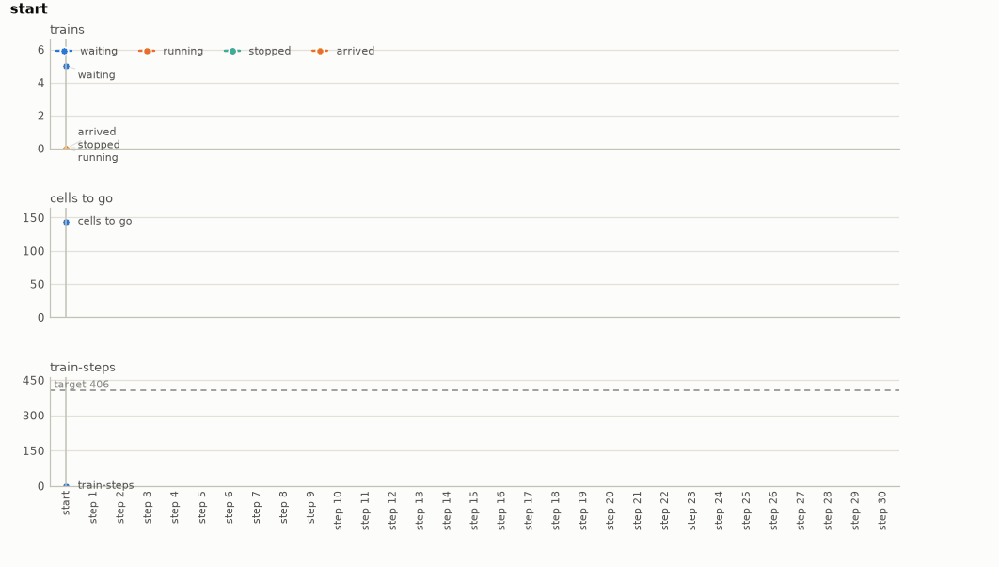

# Railway

Train dispatching on Flatland. A few cities on a grid, joined by single-track lines that Flatland
lays out from a seed, and a handful of trains waiting in their stations, each for a target in
another city. A decision is either to let one waiting train depart or to wait while the trains
already out run on. The goal is every train at its target before the horizon with the total of
their arrival steps under the target, and the plan is the sequence of departures and waits that
gets them there without a deadlock.

- **Import:** `from planiverse.environments.operational.railway.environment import RailwayEnv`
- **Source:** [`planiverse/environments/operational/railway/environment.py`](../../planiverse/environments/operational/railway/environment.py)
- **Instances:** 100 timetables, indices `0` to `99`, all drawn by the generator at recorded seeds
- **Generator:** `generate_instance(seed, cities=None, trains=None, size=None, ...)`; see [Generating timetables](#generating-timetables)
- **Dependency:** `flatland-rl`

## Context

The game here is the one a dispatcher plays on a rural network. The cities are joined by single
track, and each city has a pair of platforms where trains can stand side by side. Trains run
both ways along the same track, so two trains that set off towards each other on one line meet
head-on between the cities. Neither can reverse, and neither can ever move again. A dispatcher
avoids this by choosing when each train leaves. One train at a time is always safe and always
slow. All at once is fast when the routes do not cross and a deadlock when they do. The plan is
the departures in between: which trains can share the network, and which must wait for another
to clear a line first. What makes it hard is that whether two trains meet depends on when each
reaches each stretch of track, which depends on every train ahead of it, and that is only known
by running the trains.

[Flatland](https://github.com/flatland-association/flatland-rl) (MIT; Mohanty et al. 2020,
"Flatland-RL: multi-agent reinforcement learning on trains", https://arxiv.org/abs/2012.05893) is
the railway scheduling simulator begun by SBB with AIcrowd and now kept by the Flatland
Association. A network is a grid of cells, each holding a piece of track (a straight, a curve, a
switch or a crossing) that says which way a train may leave it for each way it came in. A train
occupies one cell, moves at most one cell a step, and stops when the cell it needs is taken. It
is a dependency installed from PyPI; nothing of it is included here. The network is drawn by its
`sparse_rail_generator` and the trains' stations and targets by its `sparse_line_generator`,
both from the instance's seed.

The rules are four. First, the network is Flatland's: `cities` cities on a `size` by `size`
grid, one track between neighbouring cities and one pair of platforms in each, with
malfunctions off. The trains are Flatland's too, each with a station, a direction to leave in
and a target in another city, all running at full speed. Flatland's timetable would hold each
train back to an earliest departure; here every train may leave from step 0, since the
departures are the plan. Second, a departed train follows its shortest route: at each switch it
takes the branch Flatland's distance map says is nearest its target. It waits where the next
cell is taken and leaves the map when it arrives. Third, a set of trains each waiting for a cell
another of them holds can never move again, and that is a deadlock and a dead end. Fourth, the
goal is every train arrived before the horizon with the train-steps (i.e., the number of trains
not yet arrived, summed over every step) under the target. The horizon passing with a train out
is a dead end, and so are train-steps over the target.

## Actions

| Action | Cost | Steps | Effect |
|---|---|---|---|
| `depart(i)`, `i` a train not yet let go | 1 | 0 | train `i` may leave its station; it enters the map as soon as its first cell is free |
| `wait` | 1 | 4, or to the end | the trains let go run on their routes for four steps, or, once every train has been let go, until every train has arrived, a deadlock or the horizon |

With `n` trains, at most `n + 1` actions apply in a state. `get_actions` offers the `n`
departures and `wait`. `successors` gives `depart(i)` for each train not yet let go, in index
order, and `wait`, and an action that does not apply leaves the state unchanged. A goal or
dead-end state has no successors at all. A departure takes no time, so several trains can be
let go at the same step. A `wait` stops early at a deadlock, at every train arrived, at the
horizon or once the train-steps pass the target. Applying `wait` steps Flatland one step at a
time: each train let go is given the move along its shortest route, and each train still in its
station is given nothing. Flatland then settles who moves, one train to a cell. The successor
is obtained by restoring the parent's snapshot of Flatland's agents into the one simulator the
environment keeps and stepping it on, so a child costs at most four simulator steps.

## Planning problem

A `RailwayState` holds the step, each train's status (`waiting`, `running`, `stopped` or
`arrived`), cell and direction, the trains let go, the train-steps so far, the cells the trains
still have to run along their routes and the trains in a deadlock, with a pickled snapshot of
Flatland's agents kept to expand from. Two states are the same state when their step, trains,
departures and train-steps are the same, since Flatland is deterministic and moves a train on
nothing else. Two orders of letting trains go at the same step are therefore one state. The
literals name the step, each train's status and cell, the trains let go and any deadlock, and
the train-steps in bands of ten. They are what the width-based planners' novelty tests see:

```
step(44)
train(0, arrived)
train(1, running)
train(2, running)
train(3, waiting)
train(4, waiting)
at(1, 17, 0)
at(2, 17, 17)
released(0)
released(1)
released(2)
train_steps(210)
```

With `T` the horizon in steps, `V` the target in train-steps and `left(s)` the trains not yet
arrived, the goal and the dead end are

```
goal(s)     ≡ left(s) = 0 ∧ train_steps(s) ≤ V
terminal(s) ≡ ¬goal(s) ∧ (deadlocked(s) ≠ ∅ ∨ train_steps(s) > V ∨ step(s) ≥ T ∨ left(s) = 0)
```

Note that the problem as a dispatcher would state it is not an initial-to-goal problem but a
trajectory problem (i.e., one whose requirements hold over the whole run rather than at its
end). No two trains may lock each other at any step, and the trains should arrive early. We
turn it into the goal above with the reduction the other operational environments share, which
[docs/operational.md](../operational.md) sets out in full, in three moves. First, a constraint
that must hold throughout becomes a dead end: the first state with a deadlock is terminal, so no
plan through it exists. A check over the whole trajectory thus becomes a check at each state.
Second, a quantity that accumulates becomes part of the state and is bounded at the goal. The
train-steps are carried on the state, added to every step, and compared with the target once
every train is in. Since they only grow, a state already over the target is a dead end too.
Third, the horizon becomes time in the state: the step is a state variable, so "by the horizon"
is a condition on a state. The cost of the reduction is that the goal depends on a target, and
a target has to come from somewhere. Here it is the least train-steps any scripted dispatching
rule gets every train home with (see [Generating timetables](#generating-timetables)), and a draw
on which letting every train go at once is already best is thrown back. Every instance is thus
solvable by construction, and the planner is asked to do at least as well as the best rule by
choosing the departures.

The progress measure the width planners take (`planiverse.benchmark.measures.railway`) is the
cells the trains still have to run plus the trains not yet arrived. A deadlock or train-steps
over the target are worse than any of them.

## An example

Instance `0` is three cities on a 25 by 25 grid: one in the north, one in the south-west and one
in the south-east. Five trains wait in them. Trains 0 and 4 stand in the northern city, for the
south-west and the south-east. Trains 1 and 3 stand in the south-western city, for the north and
the south-east. Train 2 stands in the south-eastern city, for the south-west. Their routes are
33, 33, 40, 14 and 24 cells. The horizon is 157 steps and the target 406 train-steps. The
thirty-decision plan the render below shows is

```
depart(0), wait, wait, wait, wait, wait, wait, wait, wait, wait, depart(1), wait, depart(2),
wait, wait, wait, wait, wait, wait, wait, depart(4), wait, wait, wait, wait, wait, wait, wait,
depart(3), wait
```

which sends train 0 out alone and lets it reach the south-west by step 36. Train 1 then leaves
the south-west for the north, and train 2 leaves the south-east four steps later, so the two run
together. Train 4 leaves the north at step 68, while trains 1 and 2 are still out. Train 1 is in
by step 72, train 2 by step 84 and train 4 by step 96. Train 3, whose route is the shortest,
then leaves last and is in at step 111, with 390 train-steps in all. Letting every train go at
once locks trains 2 and 4 head-on at step 14. Letting them go one a `wait` deadlocks as well, in
either order. One at a time in index order runs over 406 train-steps before its third train is
in. One at a time, shortest route first, ends at 406, which is where the target comes from.



The render draws the readings of each state over the plan rather than the state's text, since a
state here is a handful of numbers. The panels are the trains waiting, running, stopped and
arrived, the cells they still have to run, and the train-steps against the target, decision by
decision. A frame of the GIF is the chart up to its state, so the animation grows a step at a
time. The same plan is also a [sheet](../renders/railway_chart.png), the whole plan on one
figure. There the action that produced each state runs along the bottom, the target is a dashed
line, and the goal is marked where the plan ends. Both were generated by solving the instance
and handing the trace to `render_trace`:

```python
from planiverse.environments.operational.railway.environment import RailwayEnv
from planiverse.benchmark import measures
from planiverse.planners.width import BFWS

env = RailwayEnv()
env.set_index(0)
state, info = env.reset()          # info: timetable, trains, cities, horizon, target, generated
print(state)                       # step 0: 0 of 5 arrived, 0 running, 0 stopped, 5 waiting; ...

result = BFWS(width=1, progress=measures.railway).solve(env)
trace = env.simulate(result.plan)

env.render_trace(trace, "railway_chart.gif")                                   # animated
env.render_trace(trace, "railway_chart.png", actions=result.plan, env=env)     # the sheet
```

Stateful play goes through the environment's OpenSpiel game,
`pyspiel.load_game("planiverse_railway")`, whose `apply_action` advances a state (see [Through
OpenSpiel](../../README.md#through-openspiel)). `successors(state)` returns the action and state
pairs for the departures still to make and `wait`. The readings a state charts, and the panels
they go on, are its own `readings()` and `panels`; `charts=False` asks `render_trace` for the
state's text instead, and [docs/rendering.md](../rendering.md) covers the other output formats.

## Timetables

The hundred timetables are the generator's own draws, embedded in the module as the plain data
`set_instance` takes (`seed`, `cities`, `trains`, `size`, `horizon`, `target`, `solved_at`) with
the seed each came from beside it. `seed` is Flatland's, for the network and the trains, and
`solved_at` is the length of the plan the timetable was accepted on, which is in
`tests/data/railway_solutions.json`. Timetables have two to four cities, two to five trains and
grids of 25 to 35 cells a side.

## Generating timetables

`generate_instance` draws a timetable, selects it, and returns it as the dict `set_instance`
takes back:

```python
env = RailwayEnv()
timetable = env.generate_instance(seed=7, trains=3)
print(env.witness, env.witness_expansions)     # the rule's plan it was accepted on, and the rules run
```

| Option | Default | What it does |
|---|---|---|
| `cities` | 2, 3 or 4 | the most cities Flatland places |
| `trains` | 2, 3, 4 or 5 | the trains |
| `size` | 25, 30 or 35 | the side of the grid, in cells |
| `attempts` | 60 | draws before giving up with `GenerationError` |

Flatland draws the network and the trains from a seed the generator draws. The horizon is
Flatland's own episode length for the network, lengthened where needed to the step at which
letting the trains go one at a time, in index order, gets the last one home. Five dispatching
rules are then run: every train at once; one at a time, each when the last has arrived, in index
order and shortest route first; and one a `wait`, in the same two orders. The target is the
least train-steps any of them gets every train home with, and that rule's plan is the witness.
A draw is thrown back when Flatland cannot lay it out, when a train has no route to its target,
when no rule gets every train home, or when every train at once does as well as any, since then
nothing needs deciding. The same seed and options always give the same timetable.

## Determinism

Flatland is deterministic with malfunctions off, which is its default and how the environment
builds it: the network, the trains and every step follow from the seed and the moves given. The
environment keeps one `RailEnv` per instance and gives each state a pickled snapshot of its
agents (their states, cells, directions and speed counters), with the step and the trains let
go. Expanding a state restores that snapshot and steps on from it, so a successor never depends
on what was expanded before it. The tests check this by expanding a state twice and by
replaying a plan from the start, and a plan replayed through `simulate` meets the same states
as one run straight through Flatland without restoring.

## Rendering

`str(state)` describes the network in a line: the step, the trains arrived, running, stopped and
waiting, the cells still to run, the train-steps against the target and any trains deadlocked,
for example `step 44: 1 of 5 arrived, 2 running, 0 stopped, 2 waiting; 101 cells to go; 211
train-steps of 406`. `render_trace` charts the readings rather than the text, as in the example
above.

## Files

| File | Contents |
|---|---|
| [`environment.py`](../../planiverse/environments/operational/railway/environment.py) | `RailwayAction`, `RailwayState`, `build`, `reference_policies`, `RailwayEnv`, `TIMETABLES` |
| [`tests/test_railway.py`](../../tests/test_railway.py) | Tests |
| [`tests/data/railway_solutions.json`](../../tests/data/railway_solutions.json) | The rule's plan each timetable was accepted on |
